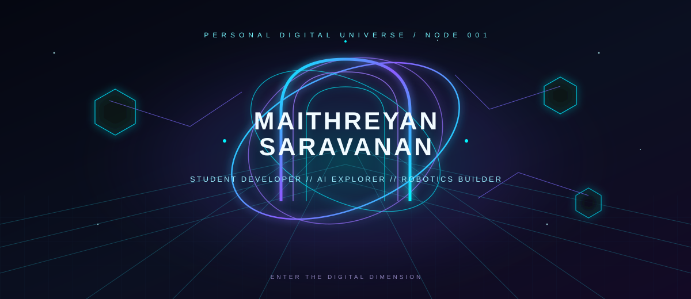

<div align="center">

<!-- 01 — DIGITAL ENTRY: LOCAL SELF-CONTAINED SVG HOLOGRAPHIC BANNER -->
<a href="https://portfolio.maithreyan120.workers.dev/">
  
</a>

<!-- SYSTEM TELEMETRY & LIVE TYPING SUBSYSTEM -->
<a href="https://git.io/typing-svg">
  
</a>

<br/>

<!-- STATUS INDICATOR PILL -->


</div>

<br/>

---

## `01 // DIGITAL_ENTRY`

```text
╔════════════════════════════════════════════════════════════════════════════════════════════╗
║  ███╗   ███╗ █████╗ ██╗████████╗██╗  ██╗██████╗ ███████╗██╗   ██╗ █████╗ ███╗   ██╗        ║
║  ████╗ ████║██╔══██╗██║╚══██╔══╝██║  ██║██╔══██╗██╔════╝╚██╗ ██╔╝██╔══██╗████╗  ██║        ║
║  ██╔████╔██║███████║██║   ██║   ███████║██████╔╝█████╗   ╚████╔╝ ███████║██╔██╗ ██║        ║
║  ██║╚██╔╝██║██╔══██║██║   ██║   ██╔══██║██╔══██║██╔══╝    ╚██╔╝  ██╔══██║██║╚██╗██║        ║
║  ██║ ╚═╝ ██║██║  ██║██║   ██║   ██║  ██║██║  ██║███████╗   ██║   ██║  ██║██║ ╚████║        ║
║  ╚═╝     ╚═╝╚═╝  ╚═╝╚═╝   ╚═╝   ╚═╝  ╚═╝╚═╝  ╚═╝╚══════╝   ╚═╝   ╚═╝  ╚═╝╚═╝  ╚═══╝        ║
║  [ NODE: maithreyan-saravanan17-sketch ]  //  [ PROTOCOL: BUILD -> TEST -> ITERATE ]       ║
╚════════════════════════════════════════════════════════════════════════════════════════════╝
