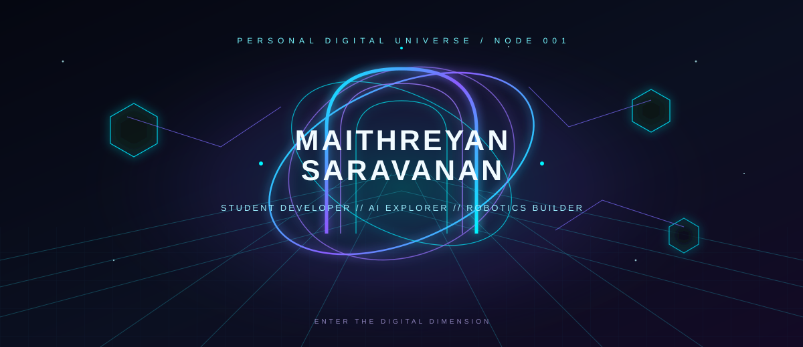
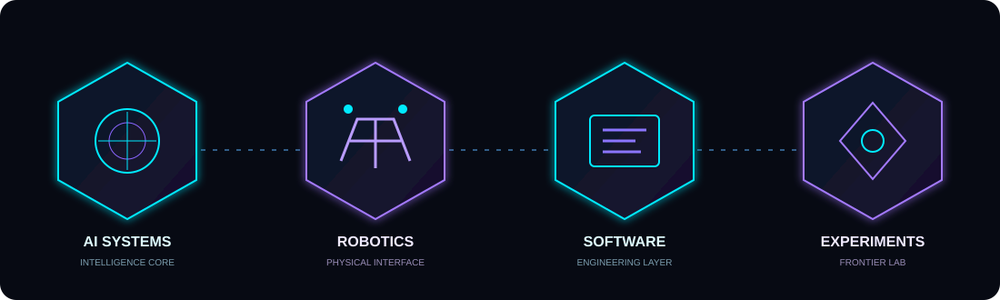
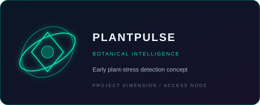
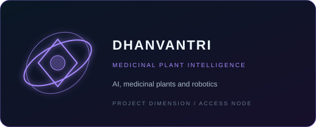
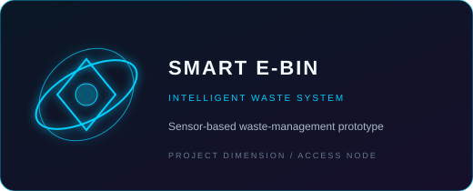
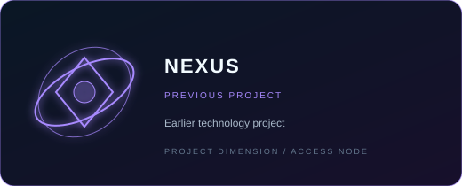
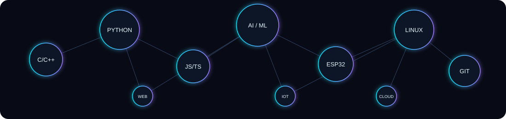

<div align="center">

<a href="https://portfolio.maithreyan120.workers.dev/">
  
</a>


<br/>


</div>

---

## `01 / DIGITAL IDENTITY`

<div align="center">
  
</div>

I’m **Maithreyan Saravanan** — a student developer exploring the space where software, artificial intelligence, robotics and physical computing intersect.

I like turning ideas into working experiments: writing software, connecting hardware, testing assumptions and iterating on what I build.

```text
IDENTITY      : STUDENT DEVELOPER
INTERESTS     : AI / ROBOTICS / EMBEDDED SYSTEMS / SOFTWARE
WORKFLOW      : BUILD -> TEST -> ITERATE
CURRENT MODE  : LEARNING THROUGH EXPERIMENTATION
```

## `02 / THE DIGITAL UNIVERSE`

<div align="center">
  
</div>

| Dimension | Exploration |
|:--|:--|
| **Intelligence core** | AI concepts, machine learning and practical AI experiments |
| **Physical interface** | Robotics, microcontrollers, sensors and embedded systems |
| **Engineering layer** | Web development, programming and software architecture |
| **Frontier lab** | Prototypes that combine software, electronics and real-world problems |

## `03 / PROJECT DIMENSIONS`

Each project is a separate world in the wider ecosystem. Status labels describe the known development stage; they are not claims of completed performance.

<table>
<tr>
<td width="50%" valign="top">
  
  **PlantPulse** · `PLANNING / PROTOTYPE DESIGN`

  A botanical intelligence concept designed to detect plant stress before visible damage appears.

  **Core direction:** ESP32 sensing with laptop-based processing.

  [Repository — add link](https://github.com/maithreyan-saravanan17-sketch/REPLACE_WITH_PLANTPULSE_REPO)
</td>
<td width="50%" valign="top">
  
  **Dhanvantri** · `DEVELOPMENT PROJECT`

  An AI, medicinal-plant and robotics ecosystem exploring plant identification and connected robotic experiences.

  [Project website](https://dhanvantri-landingpage.pages.dev/) · [Repository — add link](https://github.com/maithreyan-saravanan17-sketch/REPLACE_WITH_DHANVANTRI_REPO)
</td>
</tr>
<tr>
<td width="50%" valign="top">
  
  **Smart E-Bin** · `PROTOTYPE`

  An intelligent waste-bin prototype combining sensors, a microcontroller and automated interaction.

  [Repository — add link](https://github.com/maithreyan-saravanan17-sketch/REPLACE_WITH_SMART_E_BIN_REPO)
</td>
<td width="50%" valign="top">
  
  **Nexus** · `PREVIOUS PROJECT`

  An earlier technology project in the development archive.

  [Repository — add link](https://github.com/maithreyan-saravanan17-sketch/REPLACE_WITH_NEXUS_REPO)
</td>
</tr>
</table>

## `04 / TECHNOLOGY CONSTELLATION`

<div align="center">
  
  <br/><br/>
  
</div>

*An evolving toolkit — not a claim of equal proficiency across every technology.*

## `05 / GITHUB TELEMETRY`

<div align="center">
  
  
  <br/>
  
</div>

## `06 / CURRENT TRANSMISSION`

<div align="center">
  
</div>

```console
maithreyan@digital-universe:~$ status

> BUILDING THE NEXT DIMENSION
> STATUS: EXPERIMENTING
> PROTOCOL: BUILD // TEST // ITERATE
> CONNECTION: OPEN
```

## `07 / CONNECTION PORTAL`

<div align="center">

<a href="https://github.com/maithreyan-saravanan17-sketch"></a>
<a href="https://www.linkedin.com/"></a>
<a href="https://www.instagram.com/maithreyan.dev/"></a>
<a href="https://portfolio.maithreyan120.workers.dev/"></a>

<br/><br/>

<sub>DESIGNED IN THE PRESENT. BUILT FOR WHAT'S NEXT.</sub>

</div>
